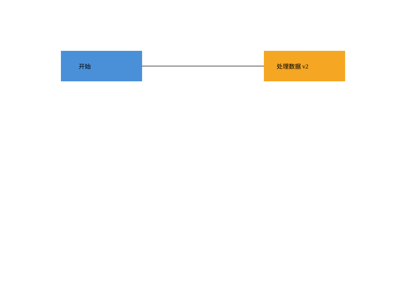

# Lab 1 — SVG CLI 编辑器（Phase 2：插件式重构）

[](https://github.com/Skitre/advsoftware-lab1-svg-editor/actions/workflows/ci.yml)

TypeScript 面向对象课程作业。Phase 1 实现了六种 SVG 图形、组合树编辑、命令撤销/重做和 SVG 读写；Phase 2 把它重构为“内核 + 四个扩展点 + 插件”，并新增一个 VSCode 扩展。

- **Phase 2 提交文档：[doc/README.md](doc/README.md)**，包含扩展点清单、两种装配方式、PlantUML 依赖图、ADR、VSCode 插件分析和过程记录。
- 代码指标：[docs/metrics/README.md](docs/metrics/README.md)，由 `npx tsx scripts/metrics.ts final HEAD` 生成。
- VSCode 扩展：[vscode-extension/](vscode-extension/README.md)。
- 版本：Phase 2 = tag [`p2`](https://github.com/Skitre/advsoftware-lab1-svg-editor/tree/p2)，Phase 1 = tag [`final`](https://github.com/Skitre/advsoftware-lab1-svg-editor/tree/final)（Phase 1 文档：[doc/phase1.md](doc/phase1.md)）。

## 运行

需要 Node.js 22 或以上版本。源码由 `tsx` 直接运行，不需要构建。

```sh
npm ci
bin/svg-editor                                   # 方式 A：组合根代码装配
bin/svg-editor --config plugins.config.json      # 方式 B：按配置文件装配
bin/svg-editor --list-plugins                    # 查看装入的插件及顺序
```

输入 `help` 查看命令，`Ctrl-D` 退出。示例：

```text
init 800 600
create box n1 120 100 160 60 "开始"
create rect r1 400 100 120 60 #f5a623
set n1 label "处理数据"
stats
tree
dir
save demo.svg
```

## 目录

| 路径 | 内容 |
| --- | --- |
| `packages/kernel` | `@svgframe/kernel`：领域模型、会话与撤销、注册表、CLI 内核、SVG 读写、扩展点接口 |
| `plugins/*` | `builtin-shapes`、`builtin-commands`、`command-stats`、`command-dir`、`shape-box`、`tree-star` |
| `src/` | 宿主：组合根 `main.ts`、插件安装器、配置加载器 |
| `plugins.config.json` | 方式 B 的插件列表 |
| `doc/` | 提交文档、PlantUML 图、截图、回放会话与预期输出 |
| `docs/metrics/` | 脚本生成的代码指标 |
| `vscode-extension/` | SVG 文件 `[]` 标记与大纲的 VSCode 扩展 |

## 验证

```sh
npm run check                             # 严格类型检查 + 97 项测试
bin/svg-editor < examples/flowchart.commands
cd vscode-extension && npm ci && npm test && npm run test:vscode
```


