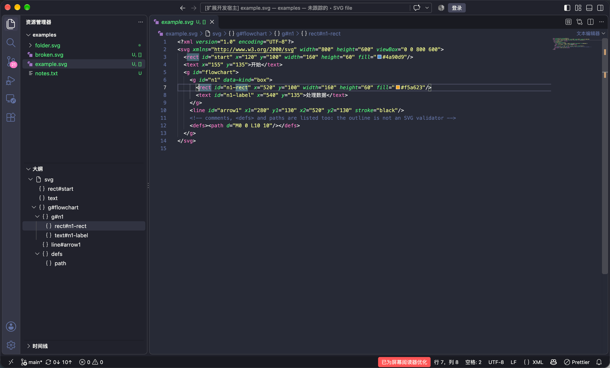
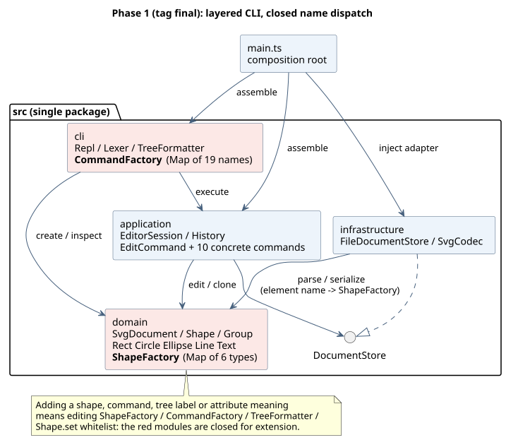
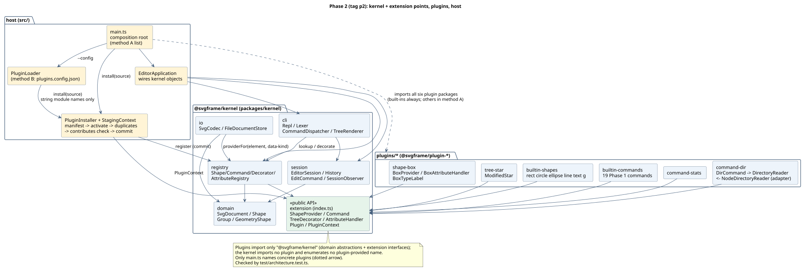

# Lab 1 Phase 2：插件实践与插件式重构

- 仓库：<https://github.com/Skitre/advsoftware-lab1-svg-editor>，Phase 2 最终版本为 tag **`p2`**，Phase 1 基线为 tag `final`（`d826d99`）。
- 范围：第一部分（VSCode 插件）与第二部分（CLI 插件式重构）为个人完成；第三部分（deepseek harness 插件）为小组作业，不在本文档内。
- Phase 1 的提交文档原文移到了 [`doc/phase1.md`](phase1.md)（`final` 时它就是 `doc/README.md`，只在开头加了一行说明）。
- 代码指标见 [`docs/metrics/README.md`](../docs/metrics/README.md)，由 [`scripts/metrics.ts`](../scripts/metrics.ts) 从 git 历史生成。

```bash
npm ci
npm run check                                        # 类型检查 + 全部 CLI 测试（97 项）
bin/svg-editor                                       # 方式 A：代码装配（默认）
bin/svg-editor --config plugins.config.json          # 方式 B：配置装配
bin/svg-editor --list-plugins [--config <file>]      # 打印实际装入的插件及顺序
cd vscode-extension && npm ci && npm test && npm run test:vscode   # VSCode 扩展单元测试 + 真实 VSCode 集成测试
```

目录：

1. [第一部分：VSCode 插件实践](#1-第一部分vscode-插件实践)
2. [CLI 架构总览与模块依赖图](#2-cli-架构总览与模块依赖图)
3. [扩展点清单](#3-扩展点清单)
4. [两种装配方式与配置格式](#4-两种装配方式与配置格式)
5. [命令插件 stats 与 dir（适配器模式）](#5-命令插件-stats-与-dir适配器模式)
6. [box 插件与树标签插件](#6-box-插件与树标签插件)
7. [ADR](#7-adr)
8. [与 Phase 1 的兼容性与已知差异](#8-与-phase-1-的兼容性与已知差异)
9. [测试与验证证据](#9-测试与验证证据)
10. [迭代报告：Phase 1 → Phase 2](#10-迭代报告phase-1--phase-2)
11. [过程记录：AI 建议的检查与修正](#11-过程记录ai-建议的检查与修正)

---

## 1. 第一部分：VSCode 插件实践

源码、安装与启动步骤见 [`vscode-extension/README.md`](../vscode-extension/README.md)；示例文件在 [`vscode-extension/examples/`](../vscode-extension/examples/)。

### 1.1 效果演示

**A.1 文件标记**：`example.svg`、`broken.svg` 右侧显示 `[]`；`notes.txt` 和名为 `folder.svg` 的**目录**没有标记，文件名不变。截图中的 `U` 是 git 的“未跟踪”状态装饰，与本插件无关——VSCode 会把多个装饰提供者的 badge 合并显示（这正是 1.3 节分析的一个现象）。

![Explorer 中的 [] 标记](images/explorer-badge.png)

**A.2 大纲与定位**：打开 `example.svg`，原生“大纲”视图显示 `svg → rect#start / text / g#flowchart → g#n1 → rect#n1-rect …`，无 id 的 `text`、`defs`、`path` 只显示标签名；点击 `rect#n1-rect` 后光标定位到第 7 行并选中标签名 `rect`，面包屑同步显示 `svg › g#flowchart › g#n1 › rect#n1-rect`。



**先观察 VSCode 现有行为**（要求“先观察再实现”，以下为实测记录）：

| 观察 | 结论 |
|---|---|
| 用只含空扩展的 VSCode 1.146.0 打开 `example.svg`，执行 `vscode.executeDocumentSymbolProvider` | 语言 id 为 `xml`；内置 `vscode.xml` 只提供语法着色，返回 `null`，即**没有任何大纲提供者**，大纲视图为空 |
| 双击 `.svg` 默认以 **Image Preview**（自定义编辑器）打开 | 自定义编辑器不是文本文档，VSCode 不向任何插件请求大纲；须“重新打开编辑器的方式… → 文本编辑器”后大纲才出现（手动截图时实际遇到，见第 11 节） |
| 大纲视图在编辑后自动刷新、点击节点跳到 `selectionRange` | 这是 VSCode 的职责：插件只需在被调用时返回符号树及其范围，不需要自己监听编辑或移动光标 |

### 1.2 验证证据

| 要求 | 单元测试（`npm test`，6 项，不需要 VSCode） | 集成测试（`npm run test:vscode`，真实 VSCode 1.146.0） |
|---|---|---|
| 嵌套分组 | 示例完整大纲树逐行断言 | 经 VSCode 命令取回的符号树逐行断言 |
| 无 id 元素 | `text`、`defs`、`path` 只显示标签名 | 同上 |
| 编辑更新 | 插入/改名/删除元素后重新解析 | `WorkspaceEdit` 插入 `<circle id="added">` 后再次查询出现 `circle#added` |
| 不完整 XML | 11 种畸形输入均返回“无大纲”且不抛异常；`broken.svg` | 删除 `</svg>` 后大纲为空、扩展仍处于激活状态；`undo` 后恢复；`broken.svg` 大纲为空 |
| 定位 | `rect#start` 的范围在第 3 行、选区恰为 `rect` | `rect#start` 的 `selectionRange` 在第 3 行 |
| 标记只给 SVG 文件 | `a.svg`/`A.SVG` 是，`folder.svg`（目录）、`notes.txt`、`a.svg.txt` 否 | 对真实工作区文件调用装饰提供者：两个 svg 为 `[]`，`notes.txt`、`folder.svg/` 无 |

集成测试的实际输出（原样）：

```text
VSCode 1.146.0 integration evidence:
outline example.svg:
  svg
    rect#start
    text
    g#flowchart
      g#n1
        rect#n1-rect
        text#n1-label
      line#arrow1
      defs
        path
after inserting <circle id="added">: circle#added listed
after deleting </svg>: outline empty, extension still active
broken.svg: outline empty
decoration example.svg: []
decoration broken.svg: []
decoration notes.txt: (none)
decoration folder.svg: (none)
```

CI（`.github/workflows/ci.yml` 的 `vscode-extension` 作业）在 Linux 上用 `xvfb-run` 下载 VSCode 重跑这两组测试。

### 1.3 A.3 分析

#### VSCode 与插件的职责、注册与调用过程

| 角色 | 职责 |
|---|---|
| VSCode（宿主） | 管理窗口、Explorer、编辑器、大纲视图；决定**何时**需要装饰或大纲（渲染 Explorer 条目、切换/编辑文档时）；缓存与合并多个提供者的结果；处理点击跳转、面包屑、编辑后的防抖刷新；隔离扩展进程，扩展抛错不影响工作台 |
| 插件 | 只回答“这个文件的装饰是什么”“这段文本的符号树是什么”；不读写文件名或内容，不操作视图 |

过程（控制反转 / 好莱坞原则）：

1. `package.json` 声明 `activationEvents: ["onStartupFinished"]` 与入口 `main`；VSCode 在启动完成后于扩展宿主进程中加载 [`extension.ts`](../vscode-extension/src/extension.ts) 并调用 `activate(context)`。
2. `activate` 调用 `vscode.window.registerFileDecorationProvider(new SvgFileDecorationProvider())` 与 `vscode.languages.registerDocumentSymbolProvider([{ pattern: '**/*.svg' }, { language: 'svg' }], new SvgDocumentSymbolProvider())`，把返回的 `Disposable` 放入 `context.subscriptions`（停用时由 VSCode 统一注销）。选择器用文件模式而非语言 id，因为 VSCode 把 `.svg` 识别为 `xml`。
3. 此后插件不再主动做事：Explorer 渲染每个条目时 VSCode 调 `provideFileDecoration(uri)`；大纲视图/面包屑需要符号时调 `provideDocumentSymbols(document)`，文档编辑后会再次调用。返回值是纯数据（`FileDecoration`、`DocumentSymbol[]`），由 VSCode 渲染。

#### 文件装饰与经典 Decorator、Adapter 的对应和差异

| 对照点 | 经典 Decorator（GoF） | VSCode 文件装饰 |
|---|---|---|
| 接口 | 装饰者与被装饰者实现**同一接口** `Component`，客户端无感知 | `FileDecorationProvider` 与 Explorer 条目**不是**同一接口；提供者只返回一份数据 `FileDecoration{badge, tooltip, color}` |
| 对象组合 | 装饰者**持有**被装饰对象引用，形成包装链 `D2(D1(C))`，调用沿链转发 | 没有包装链；VSCode 持有一组**并列**的提供者，对同一 URI 逐个询问后**合并**结果（截图中 `U, []` 即 git 与本插件的结果被合并） |
| 调用关系 | 客户端调外层装饰者，装饰者先/后调用内层再追加行为 | VSCode 调每个提供者；提供者之间互不调用、互不感知，也无法修改其他提供者的结果 |
| 相同之处 | 意图一致：**不修改原对象**（文件名、文件内容不变），在运行时给它“附加”职责/信息；可任意叠加、可单独移除 | |
| 差异总结 | 结构上更接近“Observer/Visitor 式的扩展点 + 宿主侧合并”，Decorator 只在“附加而不修改”这一意图层面成立 | |

本仓库 CLI 的 `TreeDecorator` 采用了同样的“并列提供者 + 宿主合并”形态（`TreeRenderer.decorate` 依次询问并拼接 `(box)`、`*`），而非包装链，原因相同：标签互不感知、可独立启停（见 ADR-3 的拼接顺序）。

Adapter 的对应：两个提供者类都是 **Adapter**——Target 是 VSCode 定义的 `FileDecorationProvider` / `DocumentSymbolProvider` 接口，Adaptee 是不依赖 VSCode 的核心类（[`SvgFileFilter`](../vscode-extension/src/core/SvgFileFilter.ts)、[`SvgOutlineParser`](../vscode-extension/src/core/SvgOutlineParser.ts)），Client 是 VSCode。适配器负责数据转换：`uri` → 路径与 `fs.stat` 结果 → `isSvgFile`；字符偏移 `start/end/nameStart/nameEnd` → `document.positionAt` → `Range`，元素树 → `DocumentSymbol` 树（根 `File`、容器 `Namespace`、叶子 `Object`）。这样核心逻辑可以在 Node 里直接单元测试，CLI 的 `dir`（第 5 节）也是同一模式。

#### Phase 1 解析、模型与遍历代码的复用评估

| Phase 1 模块 | 能否复用 | 原因 |
|---|---|---|
| `SvgCodec`（xmldom 解析） | **不能** | ① DOM 节点不保留源码偏移，无法生成 `Range`/定位；② 解析失败抛错并拒绝整个文件，而大纲需要“无大纲但不崩溃”的语义；③ 它只接受 6 种图形与 `g`，遇到 `defs`、`path` 等直接报 `unknown shape type`，而大纲必须列出所有元素；④ 会为缺 id 的元素分配 `rect1` 之类的 id，大纲应如实显示 `rect` |
| 领域模型 `SvgDocument/Shape/Group` | **不能直接复用** | 模型是编辑语义（几何校验、id 唯一、不变量），不携带源码位置；把任意 SVG 强行装进模型会丢元素或报错 |
| 树遍历（`TreeRenderer.branches` 的深度优先、`tag#id` 命名约定） | **思路复用** | 大纲采用相同的深度优先顺序和 `tag#id` / `tag` 命名，但遍历对象是带偏移的 `SvgElementNode`，代码量很小，抽成共享包的收益低于跨包依赖（VSCode 扩展用 CommonJS + `tsc`，CLI 用 ESM + `tsx`）的成本 |
| 可复用的部分 | 测试数据与约定 | `example.svg` 取自 Phase 1/2 的流程图（含 `data-kind="box"`），命名约定一致 |

因此新写了一个约 100 行的“遇错即拒绝”的偏移扫描器 `SvgOutlineParser`：保留每个元素及其标签名的偏移；处理注释、CDATA、处理指令、DOCTYPE 内部子集、带引号属性（含 `>`）、实体解码的 id；对不匹配/未闭合标签、未终止的注释或字符串、无引号属性值返回 `undefined`；整个 `parse` 包在 `try/catch` 里，保证永不抛出。

---

## 2. CLI 架构总览与模块依赖图

| 位置 | 包 | 内容 |
|---|---|---|
| `packages/kernel/src` | `@svgframe/kernel` | 内核：`domain`（SvgDocument/Shape/Group/GeometryShape/Numbers）、`session`（EditorSession/History/EditCommand/SessionObserver）、`registry`（四个注册表）、`cli`（Repl/Lexer/CommandDispatcher/TreeRenderer）、`io`（SvgCodec/FileDocumentStore）、`extension`（扩展点接口）。入口 `index.ts` 是**插件 API**（领域抽象 + 扩展点接口），`host.ts` 是**装配 API**（注册表、会话等，只给宿主用） |
| `plugins/*` | `@svgframe/plugin-*` | `builtin-shapes`（6 种图形）、`builtin-commands`（Phase 1 的 19 条命令）、`command-stats`、`command-dir`、`shape-box`、`tree-star` |
| `src/` | 宿主 | `main.ts` 组合根（方式 A 列表）；`host/`：`EditorApplication`、`PluginInstaller`、`StagingContext`、`PluginManifest`、`Contributions`、`PluginConfig`、`PluginLoader`、`LaunchOptions`、诊断输出 |

依赖规则（由 [`test/architecture.test.ts`](../test/architecture.test.ts) 用 TypeScript AST 检查）：内核只向内依赖、不 import 任何插件或宿主；插件只 import `@svgframe/kernel`（不得 import 宿主、内核内部路径或其他插件）；只有 `src/main.ts` 写出具体插件名，宿主与加载器只处理字符串模块名；内核源码中不出现任何插件提供的图形类型名或命令名；生产代码一类一文件、无 `switch` 分派。

**重构前（`final`）**——源码 [`uml/phase1-modules.puml`](uml/phase1-modules.puml)：



**重构后（`p2`）**——源码 [`uml/phase2-modules.puml`](uml/phase2-modules.puml)：



图片由 PlantUML 1.2024.7 本地渲染（`java -jar plantuml.jar -tsvg doc/uml/*.puml`），随仓库提交。

---

## 3. 扩展点清单

四个扩展点的接口都在 `packages/kernel/src/extension/`，由 `@svgframe/kernel` 导出。插件在 `activate(context: PluginContext)` 中调用 `context.registerShape / registerCommand / registerTreeDecorator / registerAttributeHandler` 注册**类的实例**。登记时由对应注册表的 `validate` 立即检查结构（缺方法、名称非法等），失败表现为该插件 `activate` 抛错。

### 3.1 `ShapeProvider` —— 一种图形类型

| 项 | 内容 |
|---|---|
| 接口 | [`extension/ShapeProvider.ts`](../packages/kernel/src/extension/ShapeProvider.ts)：`type`（注册名 = `create` 关键字）、`element`（SVG 元素名）、`kind?`（`data-kind` 值）、`content: 'none'\|'text'\|'shapes'`、`syntax`（help 行）、`create(id, params)`、`restore(source, children, context)` |
| 职责 | 创建新图形；从 SVG 元素读回图形（`kind` 优先匹配，否则匹配同元素名的普通提供者）；提供 help 文案 |
| 内核调用位置 | `registry/ShapeRegistry.ts`：`ShapeRegistry.create`（`create` 命令经 `CommandContext.shapes` 调用，在可撤销编辑的草稿中执行）；`io/SvgCodec.ts`：`SvgCodec.readShape` → `ShapeRegistry.providerFor(element, data-kind)` → `ShapeRegistry.restore`；`help` 命令经 `ShapeCatalog.syntaxes()` 列出语法 |
| 已有实现 | `builtin-shapes`：`GeometryShapeProvider`（rect/circle/ellipse/line/text 5 个实例）、`GroupProvider`（g）；`shape-box`：`BoxProvider`（`box`，`<g data-kind="box">`） |
| 禁用可选扩展时 | 不装 `shape-box`：`create box …` → `error: unknown shape type: box (is the plugin loaded?)`，help 无 box 行；读入 `data-kind="box"` 的分组按普通 `g` 读回并保留 `data-kind` 属性（`ShapeRegistry.providerFor` 回落到 `kind` 为空的 `g` 提供者）。内置图形总由组合根装入 |
| 契约违反 | 登记时：`shapes contract violation: missing method create()` / `…: <type>: element must be a tag name` / `content must be none, text or shapes` 等，报为 `error: plugin failed to activate: <name> (<原因>)`；类型名或 `<element data-kind>` 键重复：`error: duplicate registration: shapes/<key>`。运行时：`create()` 返回的不是该类型、该 id 的 `Shape` → `error: shapes contract violation: <type>: create() must return a <type> shape with id <id>`，命令失败、文档不变；`restore()` 返回错误 id → 同类报错，整个 `read` 失败、原文档保留 |
| 测试 | `test/extension-points.test.ts`（注册、调用、缺省、契约）、`plugins/shape-box/test/box.test.ts` |

### 3.2 `Command` —— 一条命令

| 项 | 内容 |
|---|---|
| 接口 | [`extension/Command.ts`](../packages/kernel/src/extension/Command.ts)：`name`、`syntax`、`requiresDocument`、`execute(args: CommandArguments, context: CommandContext): readonly string[]`；`CommandContext` 提供 `session`、`shapes`、`attributes`、`commands`（help 用）、`tree` |
| 职责 | 解析参数并执行；修改文档的命令必须通过 `session.edit(EditCommand)` 以进入 undo 栈；失败时抛错且不改变会话 |
| 内核调用位置 | `cli/CommandDispatcher.ts`：`CommandDispatcher.execute` → `CommandRegistry.lookup(name)` → `command.execute(...)`；由 `cli/Repl.ts` 的 `Repl.run` 对每行输入调用。`requiresDocument` 为真时 dispatcher 先调用 `session.snapshot()`，无文档则报 `no document. use 'init' or 'read' first` |
| 已有实现 | `builtin-commands`：`DelegateCommand` × 19（Phase 1 全部命令，编辑类用 `*Edit` 命令对象）；`command-stats`：`StatsCommand`；`command-dir`：`DirCommand` |
| 禁用可选扩展时 | 不装 `stats`/`dir`：`error: unknown command: stats`，help 中不出现；两者可分别单独启用（`test/command-plugins.test.ts`） |
| 契约违反 | 登记时：`commands contract violation: missing method execute()` / `<name>: syntax must be a string` / `requiresDocument must be a boolean`；重名：`error: duplicate registration: commands/<name>`。运行时：`execute` 未返回字符串数组 → `error: commands contract violation: <name>: execute() must return string lines` |
| 测试 | `test/extension-points.test.ts`、`test/command-plugins.test.ts`、`plugins/command-*/test/*` |

### 3.3 `TreeDecorator` —— 结构树行尾标签

| 项 | 内容 |
|---|---|
| 接口 | [`extension/TreeDecorator.ts`](../packages/kernel/src/extension/TreeDecorator.ts)：`name`、`label(line: TreeLine): string \| undefined`；`TreeLine = { document, shape? }`（根 `svg (WxH)` 行无 `shape`） |
| 职责 | 为 `tree` 的每一行返回一个单行标签或不返回 |
| 内核调用位置 | `cli/TreeRenderer.ts`：`TreeRenderer.decorate`（由 `TreeRenderer.tree` 对根行和每个 `branches` 行调用）。按**注册顺序**拼接，每个标签前加一个空格；`undefined` 或空串不追加任何字符 |
| 已有实现 | `shape-box`：`BoxTypeLabel`（`box-type-label`，box 行加 `(box)`）；`tree-star`：`ModifiedStar`（`modified-star`，未保存变化加 `*`） |
| 禁用可选扩展时 | 无装饰器时 `tree` 输出与 `final` 逐字节相同（`test/baseline.test.ts`） |
| 契约违反 | 登记时：`decorators contract violation: missing method label()`；重名：`duplicate registration: decorators/<name>`。运行时：`label` 抛错 → `error: tree decorator <name> failed: <原因>`；返回非字符串或含换行 → `error: decorators contract violation: <name>: label must be a single-line string`；`tree` 整条失败，不输出半棵树 |
| 测试 | `test/extension-points.test.ts`、`test/tree-labels.test.ts`、`plugins/tree-star/test/modified-star.test.ts` |

### 3.4 `AttributeHandler` —— 属性在某图形上的语义

| 项 | 内容 |
|---|---|
| 接口 | [`extension/AttributeHandler.ts`](../packages/kernel/src/extension/AttributeHandler.ts)：`name`、`priority?`（默认 0）、`handles(shape, attribute): boolean`（纯查询）、`apply(shape, attribute, value, document): string \| void`（返回反馈行，不返回则用默认 `<label> updated: attr="value"`） |
| 职责 | 为特定图形定义属性的领域语义（例如 box 的 `fill`、`label`），不扩张内核白名单 |
| 内核调用位置 | `registry/AttributeRegistry.ts`：`AttributeRegistry.set` → `AttributeRegistry.resolve` → `handler.handles`/`handler.apply`；调用方是 `builtin-commands` 的 `SetEdit.apply`，它在 `EditorSession.edit` 的草稿文档上执行（见 ADR-1） |
| 已有实现 | `shape-box`：`BoxAttributeHandler`（`box-attributes`：`fill` → `<id>-rect`，`label` → `<id>-label` 的文本） |
| 禁用可选扩展时 | 无处理器命中时走 Phase 1 规则 `Shape.set`：白名单内属性照常修改，否则 `error: unknown attribute: <attr>`（例如普通 `g` 上 `set g1 label x`） |
| 契约违反 | 登记时：`attributes contract violation: missing method handles()` / `<name>: priority must be a finite number`；重名：`duplicate registration: attributes/<name>`。运行时：`handles` 抛错 → `error: attribute handler <name> failed: <原因>`；`handles` 返回非布尔 → `error: attributes contract violation: <name>: handles() must return a boolean`；`apply` 返回非字符串 → `…: apply() must return a string or nothing`；同为最高优先级的多个处理器 → `error: ambiguous attribute handlers for <attr> on <label>: a, b`。以上任一情况文档与 undo/redo 历史保持命令前状态 |
| 测试 | `test/extension-points.test.ts`（一个 undo 单元、缺省、冲突、部分修改后抛错、纯查询）、`test/box-integration.test.ts`（§3.4 验收） |

### 3.5 辅助接口（不是第五个扩展点）

`SessionObserver`（`session/SessionObserver.ts`）：`context.observeSession(observer)` 注册，`EditorSession.notify` 在 `init/read/save` 后发 `baseline(doc)`、在 `edit/undo/redo/canvas` 后发 `changed(doc)`，传入的是文档副本。`ModifiedStar` 用它得知保存点。观察者抛错时命令本身已经完成，报 `error: session observer failed after the command completed (<原因>)`。它随插件一同暂存、一同回滚。

---

## 4. 两种装配方式与配置格式

两种方式共用**同一条注册与校验路径** `PluginInstaller.install(source)`（[`src/host/PluginInstaller.ts`](../src/host/PluginInstaller.ts)）：

```text
解析清单 contributes（非法 → manifest mismatch）
→ 检查默认导出实现 activate(context)
→ 新建 StagingContext，调用 activate：注册只“暂存”，每项立即 validate
→ 检查重复注册（与已有注册及本插件内部）
→ 比较 contributes 声明与实际暂存（四类名称集合）
→ commit：写入注册表、挂上会话观察者
任一步失败：报错、关闭上下文、丢弃全部暂存；已成功插件保留，继续下一个
```

| | 方式 A：改代码 | 方式 B：改配置 |
|---|---|---|
| 谁实例化 / 决定装哪些 | `src/main.ts` 的 `codeAssembled` 数组（静态 import，类型检查完整） | `PluginLoader.load(configPath)` 读取 `plugins.config.json`，按字符串模块名动态 `import()` |
| 启动 | `bin/svg-editor` | `bin/svg-editor --config plugins.config.json` |
| 内置能力 | 两种方式都先由组合根装入 `builtin-shapes`、`builtin-commands`，所以禁用全部可选插件仍有 Phase 1 的 19 条命令和 6 种图形 | 同左 |
| 当前装入 | stats → dir → shape-box → tree-star | 同顺序（`--list-plugins` 两种方式输出一致，`test/assembly.test.ts` 断言） |

### 4.1 `plugins.config.json`

```json
{
  "plugins": [
    { "module": "@svgframe/plugin-command-stats" },
    { "module": "@svgframe/plugin-command-dir" },
    { "module": "@svgframe/plugin-shape-box" },
    { "module": "./plugins/tree-star" }
  ]
}
```

- 顶层只允许 `plugins` 数组；每项只允许 `module`（非空字符串，必填）、`enabled`（布尔，缺省 `true`）、`options`（对象，缺省 `{}`）。语法或结构不合法 → `error: invalid plugin config`，只用内置能力启动。
- 按数组顺序加载；`enabled: false` 完全跳过（不解析、不加载）。
- 相对路径（`./`、`../`、绝对路径）以**配置文件所在目录**为基准；包名用 Node 的模块解析规则、从配置文件目录开始查找（`createRequire(<配置目录>/plugins.config.json)`）。
- **options 传递**：加载器把该项 `options` 冻结后作为 `PluginContext.options` 交给 `activate`；方式 A 在 `PluginSource.options` 写同样的对象。插件自己校验，例如 `shape-box` 接受 `{ "fill": "#f5a623" }` 作为新建 box 的默认框体颜色，非字符串时 `activate` 抛错 → `plugin failed to activate`。`--list-plugins` 会把 options 一并打印，便于核对两种方式一致。
- 插件清单在插件包的 `package.json`：`name` 作为插件名，`contributes` 声明 `shapes / commands / decorators / attributes` 四类名称列表（缺省为空），例如 `shape-box` 声明 `shapes: ["box"], attributes: ["box-attributes"], decorators: ["box-type-label"]`。

### 4.2 加载失败的输出

| 失败 | 输出（stderr，继续启动） | 位置 |
|---|---|---|
| 模块找不到（解析时 `MODULE_NOT_FOUND`） | `error: plugin not found: <module>` | `PluginLoader.loadEntry` |
| 没有默认导出 | `error: plugin has no default export: <module>` | `PluginLoader.loadEntry` |
| 清单与实际注册不一致 | `error: plugin manifest mismatch: <name> (declared: …, registered: …)` | `PluginInstaller.install` |
| `activate` 抛错（含登记时契约违反） | `error: plugin failed to activate: <name> (<reason>)` | `PluginInstaller.install` |
| 重复注册 | `error: duplicate registration: <category>/<name>` | `PluginInstaller.install` |
| 模块存在但求值失败或其依赖缺失 | `error: plugin failed to load: <module> (<reason 首行>)` —— 题目未规定格式，自定；不会误报为 `plugin not found` | `PluginLoader.loadEntry` |
| 配置非法 / 不可读 | `error: invalid plugin config` | `PluginLoader.load` |

四条失败路径、重复注册与回滚各有测试：`test/plugin-loading.test.ts`。

### 4.3 加载器独立性

`PluginLoader`、`PluginInstaller`、`StagingContext`、`PluginConfig`、`PluginManifest`、`Contributions` 的全部 `import/require/switch`（`rg -n "import|require|switch" src/host/…` 的结果）只有 `node:fs`、`node:module`、`node:path`、`node:url`、宿主内部类和 `@svgframe/kernel/host`；`require` 只出现在 `createRequire(...).resolve(specifier)` 上，`specifier` 来自配置字符串；没有任何 `switch`、插件包名或名称映射表。`test/architecture.test.ts` 用 AST 断言“只有 `src/main.ts` 写出具体插件名”。

### 4.4 box 的两次演示提交（§6 判据）

两个演示分支从同一父提交 **P = `188c7f3`** 分出，各自接入 `shape-box`，然后用一次 octopus merge **M = `0a3e04e`** 合回 `main`。两个分支随 `p2` 一起推送，此后不再变基或压缩，因此下面的哈希保持有效：

| | 提交 C | 分支 |
|---|---|---|
| 方式 A | `d0dd145` feat(box): wire the box shape plugin by code assembly | `demo/box-code-assembly` |
| 方式 B | `fd8e3aa` feat(box): wire the box shape plugin by configuration | `demo/box-config-assembly` |

`git diff --name-status C^ C` 的实际结果：

```text
# 方式 A（d0dd145）                     # 方式 B（fd8e3aa）
M  package-lock.json                     M  package-lock.json
M  package.json                          M  package.json
A  plugins/shape-box/index.ts            M  plugins.config.json
A  plugins/shape-box/package.json        A  plugins/shape-box/index.ts
A  plugins/shape-box/src/Box.ts          A  plugins/shape-box/package.json
A  plugins/shape-box/src/BoxAttributeHandler.ts   A  plugins/shape-box/src/…（同左 5 个文件）
A  plugins/shape-box/src/BoxPlugin.ts    A  plugins/shape-box/test/box.test.ts
A  plugins/shape-box/src/BoxProvider.ts
A  plugins/shape-box/src/BoxTypeLabel.ts
A  plugins/shape-box/test/box.test.ts
M  src/main.ts
```

- 方式 A：运行代码只新增插件包、只修改一个顶层装配文件 `src/main.ts`（新增两行 import 与 `codeAssembled` 中的一项）。
- 方式 B：已有运行代码不变，新增插件包并在 `plugins.config.json` 增加一项 `{ "module": "@svgframe/plugin-shape-box" }`。
- 两者共有的元数据变更：根 `package.json` 的 `dependencies` 增加 `"@svgframe/plugin-shape-box": "0.2.0"`，`package-lock.json` 增加对应的 workspace 链接（+13/−1 行）。这是让包名能被 Node 解析的依赖声明，不含运行逻辑。
- 内核与既有插件差异为空：`git diff C^ C -- packages/kernel src/host plugins/builtin-shapes plugins/builtin-commands plugins/command-stats plugins/command-dir ':(exclude)plugins/shape-box'` 对两个 C 均无输出，且已确认这 6 个路径在 `C^` 中都存在（`git cat-file -e C^:<path>`），不是“路径不存在导致的空结果”。
- 树标签 `tree-star` 的接入提交 `e93971d` 同样满足：`git diff e93971d^ e93971d -- packages/kernel` 为空（渲染器 `TreeRenderer` 在内核中，未改动）。

### 4.5 双装配一致性

会话输入在 `doc/transcript/*.txt`（只有命令与注释），预期输出与生成的 SVG 在 `doc/transcript/expected/<会话>/`。`test/assembly.test.ts` 对 7 个会话分别用方式 A、B 在**内容固定的临时工作目录**（由 `doc/transcript/fixtures/` 复制）中运行 `src/main.ts`，日志写在该目录之外，断言两者输出、退出码、生成文件逐字节相同；插件会话还要与已审阅的录制结果一致：

| 会话 | 覆盖 |
|---|---|
| `cli-1`、`cli-2-flowchart`、`cli-3-regression` | Phase 1 §6 基础会话与回归 |
| `cli-4-commands` | `stats`、`dir`（含隐藏项、子目录、`dir` 不影响 undo） |
| `cli-5-box` | Phase 1 §6.1 版本 B 的 box 会话 |
| `cli-6-box-rules` | box 不变量、属性语义、嵌套、读回降级、重复 id |
| `cli-7-tree-labels` | `(box)` 与 `*` 并存，保存 / undo 回保存点 |

基础兼容性（禁用全部新增插件，包括树标签）：`test/baseline.test.ts` 用 `--config doc/transcript/builtin-only.config.json`（空列表）运行 cli-1/2/3，与 `scripts/generate-baseline.sh` 从 `final` tag 实际生成的输出逐字节比较。

---

## 5. 命令插件 stats 与 dir（适配器模式）

**`stats`**（`plugins/command-stats`）：`ShapeStatistics` 从画布子节点按顺序深度优先遍历，叶子按 `type` 计数、类型按首次出现排序；`g` 与 `box` 只计入 containers（box 内部的 rect/text 照常计数），根不计；空文档 `(total 0, containers 0)`。`requiresDocument = true`，只读文档快照，不经过 `session.edit`，因此不进入 undo 栈。

**`dir`**（`plugins/command-dir`）的适配器模式角色：

| 角色 | 类 / 接口 | 职责 |
|---|---|---|
| Target | `DirectoryReader`（`src/DirectoryReader.ts`）：`list(path): DirectoryEntry[]`，`DirectoryEntry = { name, kind: 'directory'\|'file'\|'symlink'\|'other' }` | 用命令自己的语言描述“需要什么样的目录访问”；读不了就抛错 |
| Adaptee | Node 的 `node:fs`：`readdirSync(path, { withFileTypes: true })` 返回 `Dirent` | 现成但接口不匹配的系统 API |
| Adapter | `NodeDirectoryReader` | 把 `Dirent` 转为 `DirectoryEntry`；按 `isDirectory/isFile/isSymbolicLink` 分类且**不跟随**符号链接 |
| Client | `DirCommand` | 只依赖 `DirectoryReader`；负责过滤、排序、格式化、错误文案 |
| 装配 | `DirPlugin(reader = new NodeDirectoryReader(), cwd = () => process.cwd())` | 两种装配方式用的是同一个 `DirPlugin` 默认实例；测试注入替身 reader 与 cwd |

显示约定：

- 标记统一宽度：`[DIR] `（含一个补齐空格）、`[FILE]`、`[LINK]`（符号链接，含指向目录的链接，不遍历其目标）、`[SPEC]`（FIFO、socket、设备等其他项），标记后再接一个空格和名称。这样目录行是 `[DIR]` + 两个空格，文件行是 `[FILE]` + 一个空格，名称列对齐，与题目示例 `[DIR]  docs` / `[FILE] demo.svg` 逐字相同。题目文字写“标记后用两个空格”，与示例中 `[FILE] demo.svg` 只有一个空格矛盾；这里**以示例为准**。
- 排序：目录一组在前，其余（文件、链接、特殊项）一组在后；组内按名称的 UTF-16 码元顺序升序（不依赖 locale，输出稳定）。
- 包含 `.` 开头的隐藏项，不列出 `.` 和 `..`；名称含控制字符（如换行）时以 JSON 转义显示，保证一项一行。
- 空目录 `(empty directory)`；读取失败 `error: cannot read directory: <path>`（`<path>` 为当前工作目录的绝对路径），之后仍可继续输入命令。
- `requiresDocument = false`；不触碰文档、dirty 状态、工作目录或 undo/redo 历史，也不触发 IO 命令后的撤销限制。

测试：`plugins/command-dir/test/dir.test.ts` 用替身覆盖混合项、空目录、隐藏项、读取失败、稳定排序与特殊项，并在临时目录上组合真实适配器；`test/command-plugins.test.ts` 验证无文档可用、有文档时成功或失败均不改变文档与历史、两种装配用的是同一实现与适配器。

---

## 6. box 插件与树标签插件

**`shape-box`** 提供三项扩展：`BoxProvider`（ShapeProvider）、`BoxAttributeHandler`（AttributeHandler）、`BoxTypeLabel`（TreeDecorator）。

- `create box n1 120 100 160 60 "开始"` 通过内核的 `ShapeCatalog` 按类型名构造部件：`rect#n1-rect`（x, y, w, h, 默认填充 `#4a90d9` 或 options.fill）与 `text#n1-label`（x+20, y+h/2+5）。插件依赖 rect/text **类型已注册**，不依赖内置图形包的代码。
- `Box extends Group`：`type = 'box'`，元素仍是 `g` 并带 `data-kind="box"`；`dissolvable = false`（`ungroup` → `error: cannot ungroup composite shape: n1`）；`ownsPart(child)` 声明两个必要部件，内核的 `SvgDocument.assertDetachable` 据此拒绝 `delete n1-rect`、`addto other n1-label`、`group pair n1-rect …`（`error: cannot detach part of composite shape: <id>`）。部件仍可就地编辑、移动、调整层次；整体 `move`/`delete`/嵌套/`in` 子句与普通容器一致。
- `tree` 中显示 `g#n1 (box)`；`show n1` 与反馈消息用 `box#n1`。

**`tree-star`**：`ModifiedStar` 同时实现 `TreeDecorator` 与 `SessionObserver`，所有状态（保存点的指纹）都在实例字段里，无模块级变量。语义见 ADR-3。实际输出（`cli-7-tree-labels`）：

```text
svg (800x600) *
└── g#flowchart *
    ├── g#n1 (box) *
    │   ├── rect#n1-rect  x=120 y=100 w=160 h=60  fill=#4a90d9 *
    │   └── text#n1-label  (140,135) "处理数据" *
    └── line#arrow1  (280,130) -> (520,130)  stroke=black *
saved to labels.svg (5 elements)
…（保存后再 set n1 fill #f5a623）
svg (800x600) *
└── g#flowchart
    ├── g#n1 (box)
    │   ├── rect#n1-rect  x=120 y=100 w=160 h=60  fill=#f5a623 *
    │   └── text#n1-label  (140,135) "处理数据"
    └── line#arrow1  (280,130) -> (520,130)  stroke=black
…（undo 回到保存点后不再有 *）
```

---

## 7. ADR

### ADR-1 属性扩展点契约（`AttributeHandler`）

- **背景**：题目给出的 `handles(shapeId, attr)` / `apply(shapeId, attr, value)` 没有说明如何拿到图形、多个处理器如何协作、如何与 undo 及失败回滚配合。
- **决定**：
  1. **访问图形**：签名改为传对象：`handles(shape, attribute)`、`apply(shape, attribute, value, document)`。处理器通过 `shape.type` 判断类型（`Box` 覆盖 `type` 为 `'box'`），通过 `document.find(Box.frameId(shape.id))` 等**公开方法**找到子部件，再用 `Shape.set` 修改；字段保持封装。`handles` 必须是纯查询，返回布尔。
  2. **冲突规则：按优先级选一个，平级拒绝**。`priority` 缺省 0，命中者中取最高；如果最高优先级有多个，整条 `set` 失败：`ambiguous attribute handlers for <attr> on <label>: a, b`，文档不变。不做组合执行，因为组合的顺序与语义无法由内核替插件决定，静默覆盖更不可接受。
  3. **一次 `set` 是一个 undo 单元**：`set` 命令是一个 `SetEdit extends EditCommand`，在 `EditorSession.edit` 中执行。`EditCommand.execute` 先 `document.clone()` 出草稿，处理器只修改**草稿**，成功后才保存 before/after 快照（Memento）并替换当前文档。所以无论改了几个部件，`undo` 一次恢复 before、`redo` 一次恢复 after。
  4. **部分修改后抛错**：异常从 `apply` 传出时，草稿被丢弃；当前文档、undo 栈和 redo 栈都没有被触碰（`History` 只在成功后入栈），等价于事务回滚，不需要处理器自己写补偿逻辑。失败**不**回落到默认白名单规则。
  5. 无处理器命中时调用 `Shape.set` 执行 Phase 1 白名单。
- **后果**：内核不需要知道 box、fill、label。代价是每次编辑复制整个文档，复杂度 O(n)，对作业规模可以接受（Phase 1 已采用同样的 Memento）。
- **验证**：`test/extension-points.test.ts` 的 “one set is one undo unit”“conflicts”“failure after a partial change restores the document and keeps undo/redo history”“handles() must be a pure boolean query”；`test/box-integration.test.ts` 的 §3.4 验收。

### ADR-2 box 的读回降级与子部件 id

- **决定**：
  1. 子部件 id 固定派生为 `<id>-rect`、`<id>-label`。`create` 在草稿上插入整棵子树，`SvgDocument` 检查**整个新子树**与已有 id 是否冲突，冲突则整条命令失败、不留下任何节点（`create rect n2-label …` 后 `create box n2 …` → `error: id already exists: n2-label`）。
  2. 装了插件但 `<g data-kind="box">` 缺少部件，或部件类型错误（例如 `<id>-rect` 不是 rect）：**警告并降级为普通 `g`**，保留原有属性（包括 `data-kind`），绝不构造不完整的 `Box`。输出为 `warning: missing part b1-label; read box b1 as plain g`。
  3. 重复 id 违反全局唯一，不能靠降级消除：`SvgCodec` 在调用任何提供者之前就拒绝整个文件（`error: id already exists: b1-rect`），`read` 失败，当前文档保持不变。
  4. 未装插件：没有 `data-kind="box"` 的提供者，按普通 `g` 读回，`data-kind` 作为属性保留，以后装上插件再读又会恢复成 box。
- **理由**：选择降级而不是拒绝整个读入，因为缺部件的分组仍是合法 SVG，用户可以继续编辑和修复，丢失的只是 box 的约束。这和“未装插件”时的行为一致，用户的心智模型只有一种。重复 id 会破坏所有命令的寻址，必须拒绝。
- **验证**：`plugins/shape-box/test/box.test.ts`（完整 box 读回、缺部件、类型错误）、`cli-6-box-rules` 会话（`broken-box.svg`、`duplicate-box.svg`）、`test/box-integration.test.ts`（未装插件时降级并保留标记，往返逐字节一致）。

### ADR-3 dirty 语义、祖先传播与标签拼接顺序（`modified-star`）

- **决定**：
  1. **dirty = 内容与上次保存点不一致**，不是“执行过编辑命令”。保存点指最近一次成功的 `init`、`read` 或 `save`，通过 `SessionObserver.baseline` 得到文档副本，记录每个 id 的内容指纹。`undo` 回到保存点后 `*` 消失；改了再改回去也视为干净；保存失败时保持原有标记。
  2. **新建节点立即标记**（保存点中没有这个 id）。
  3. **不向祖先传播**：一个图形的指纹只包括它自身的类型、标签、属性、文本和**直接子节点 id 的顺序**。修改子图形不会标记容器；容器自身的属性、成员或顺序变化（加入、移出、删除子节点、调整层次）会标记容器。根 `svg` 行在文档任何地方（包括画布尺寸）与保存点不同时都标记，因此删除节点等变化至少在根行可见。
  4. **拼接顺序 = 插件安装顺序**（即注册顺序）：方式 A 由 `main.ts` 的列表决定，方式 B 由配置数组决定，两者都是 shape-box → tree-star，所以显示为 `g#n1 (box) *`。渲染器在每个标签前加一个空格，标签彼此不感知。
- **理由**：题目示例里 `g#n1 (box)` 没有 `*`，而其子节点 `rect#n1-rect` 有，与“不传播”一致。对用户来说“这一行本身变了”比“它下面某处变了”信息更准；根行兜底说明“文档有未保存变化”。按内容比较的成本是每次 `tree` 时计算指纹，规模很小。
- **验证**：`plugins/tree-star/test/modified-star.test.ts`（编辑 → 保存 → 再编辑 → undo 回保存点；改回去即干净；保存失败；容器规则；read 重置；不同实例互不影响），`test/tree-labels.test.ts`（并存、独立、真实会话）。

### ADR-4 配置清单的校验时机

- **决定**：
  1. `contributes` 的**格式**（四类名称、字符串数组）在 `activate` **之前**校验，非法时不运行插件代码，报 `plugin manifest mismatch: <name> (declared: invalid contributes [...], registered: none)`。
  2. **声明与实际是否一致**在 `activate` **之后、commit 之前**校验：比较的是暂存的注册（类别 + 名称集合），一致才写入注册表。
  3. 单项注册的结构契约（缺方法等）在**登记当时**就由注册表 `validate`，错误会从 `activate` 中抛出，所以报为 `plugin failed to activate`。
  4. 校验顺序是：清单格式 → activate → 重复注册 → 清单一致性 → commit。任何一步失败都撤销该插件全部暂存（包括会话观察者），继续加载后面的插件。
- **理由**：不执行插件代码就无法知道它实际注册了什么，所以一致性只能事后比较；“暂存 + 统一提交”让事后比较不需要回滚已生效的注册。在登记时就校验结构，可以让错误信息指向具体是哪个对象出了问题。`activate` 结束后 `StagingContext` 被关闭，插件不能在之后偷偷注册。
- **验证**：`test/plugin-loading.test.ts` 中的 installer 系列测试（激活失败回滚、重复注册、清单精确比较、非法注册、关闭后的上下文）。

---

## 8. 与 Phase 1 的兼容性与已知差异

| 项 | 说明 |
|---|---|
| 基线 | Phase 1 的“预期输出”取自 `final` tag 的**实际运行结果**（`scripts/generate-baseline.sh`），不是 `phase_cli_1.md` 中的示例文字（两者本来就有出入）。禁用新增插件时逐字节一致 |
| undo 反馈 | 保持 Phase 1 实现的统一格式 `undone: <原消息>` / `redone: <原消息>`，由内核的 `EditCommand` 生成，对插件命令同样适用；不采用 `phase_cli_1.md` 示例中的另一种措辞 |
| 运行方式 | Phase 1 README 写的是 `node dist/main.js`。Phase 2 改为 npm workspaces 多包、源码直接以 TypeScript 运行：启动入口为 `bin/svg-editor`（内部 `tsx src/main.ts`），不再有 `dist` 构建；`npm run check` = 严格类型检查 + 测试 |
| 新增启动参数 | `--config <file>`、`--list-plugins`；非法参数 → `usage: svg-editor [--config <plugins.config.json>] [--list-plugins]`，退出码 2 |
| 新增错误文案 | `plugin failed to load: <module> (<reason>)`（见 4.2）、各扩展点的 `<category> contract violation: …`、`cannot ungroup composite shape`、`cannot detach part of composite shape`、`ambiguous attribute handlers …`、`session observer failed …` |
| 默认装配的可见变化 | 方式 A/B 默认装入全部可选插件，因此 `help` 多了 `stats`、`dir`、`box` 三行，`tree` 会出现 `*`；这是新增插件的效果，不影响禁用插件时的基线 |

---

## 9. 测试与验证证据

- `npm run check`：类型检查 + **97 项**测试全部通过，0 跳过。测试文件：`test/` 下的 architecture、domain、history、svg、cli（Phase 1 回归）、baseline、assembly、extension-points、plugin-loading、command-plugins、box-integration、tree-labels，以及每个插件包自己的 `plugins/*/test/`。
- 插件独立可测：每个插件的 `test/` 只依赖 `@svgframe/kernel` 与测试替身上下文，不依赖其他插件（`plugins/*/test/`）。
- 回放会话与预期：`doc/transcript/`；GitHub Actions 运行 `npm run check`、回放示例，并运行 VSCode 扩展的单元测试与集成测试。
- VSCode 两项效果与异常输入的证据见 1.1、1.2 节（截图 + 集成测试输出）。

---

## 10. 迭代报告：Phase 1 → Phase 2

架构对比图见第 2 节的两张 PlantUML 图。变化要点：

| 维度 | Phase 1（`final`） | Phase 2（`p2`） |
|---|---|---|
| 新增图形 | 修改 `ShapeFactory` 的 Map、`SvgCodec` 的元素分派 | 新插件实现 `ShapeProvider` 并注册；`ShapeRegistry.providerFor` 按元素名 + `data-kind` 查表 |
| 新增命令 | 修改 `CommandFactory` 的 Map | 新插件实现 `Command`；`CommandDispatcher` 只查注册表 |
| 树标签 | 修改 `TreeFormatter` | 新插件实现 `TreeDecorator`；`TreeRenderer.decorate` 不变 |
| 属性语义 | 修改 `Shape.set` 的白名单 | 新插件实现 `AttributeHandler`；白名单作为缺省规则保留 |
| 装配 | `main.ts` 手工 new | 组合根（方式 A）或配置 + 加载器（方式 B），共用安装器 |
| 包结构 | 单包四层 | 内核包 + 6 个插件包 + 宿主；插件只能看到内核的公开 API |
| 依赖检查 | AST 层级矩阵 | 层级矩阵 + 插件/宿主边界 + “内核不枚举插件名” + 一类一文件、无 switch |

数字（`docs/metrics/README.md`，脚本生成，比较 `final` 与 `5981823`。之后的提交只改了文档和度量文件本身，所以 `p2` 的 TypeScript 源码与 `5981823` 相同）：CLI 代码行 1029 → 2057，McCabe 圈复杂度 376 → 726（内核 +24，装配处 +139，插件 +187）。内核的复杂度只增加了 24，主要来自注册表的契约检查。新增能力的复杂度落在插件和装配处，这是开闭原则的预期分布：以后再加一个插件，增量会出现在 `plugins/` 中，而内核这一行不应该变化。VSCode 扩展（9 个文件，272 行代码，含其测试）单独列出，不计入 CLI 增量。

过程节点（普通提交）：

| 节点 | 提交 |
|---|---|
| 基线固定 | `163a846` test: pin Phase 1 CLI output to the final baseline |
| 框架可扩展 | `afeef1f` 四个扩展点、内核/插件/宿主拆分；`d24779a` metrics 首次产出 |
| 命令插件完成 | `c5409b3` stats、dir（含适配器及独立测试） |
| box 接入 | `188c7f3`（P）→ `d0dd145`（A）/ `fd8e3aa`（B）→ `0a3e04e`（合并）；`6adc73d` §6.1 版本 B 会话与 box 规则 |
| 标签完成 | `e93971d` modified-star 与 `(box)` 并存 |
| VSCode 实践 | `9ad2230` 文件标记、大纲、测试、截图（与 CLI 主线相互独立，按时间排在 CLI 之后完成） |
| 收尾 | `97371c6` 本文档、架构对比图、metrics；`5981823` 修复 CI 失败（见第 11 节）；随后更新 metrics 并打 tag `p2` |

---

## 11. 过程记录：AI 建议的检查与修正

分工：作业要求的解读、范围与关键语义由我决定，具体实现由 AI 编码助手（Claude Code）在每一步提出方案并编写代码。每一步完成后，我先查看方案说明、测试结果和 diff，再决定是否提交。Phase 1 使用的是 Codex。下面只记录实际发生过的检查与修正。

**由我做出或确认的决定**：

| 问题 | AI 的初始方案 / 提问 | 决定 |
|---|---|---|
| 作业范围 | 题首写“小组作业” | 确认第一、二部分为个人完成，第三部分才是小组作业，本文档不包含第三部分 |
| 仓库与文档位置 | 题目同时出现 `doc/README.md` 与 `docs/metrics/` | 沿用 Phase 1 仓库；两个目录按题目字面并存 |
| 兼容基线 | 拿 `phase_cli_1.md` 的示例文字做比对，还是拿 `final` 的实际输出 | 以 `final` 的实际输出逐字节为准；undo 反馈保留内核统一的 `undone:` |
| A/B 演示 | 在同一提交里演示，还是用两个分支 | 从同一父提交分出两个演示分支，合并回 `main`，提交哈希记入文档后不再变基 |
| modified-star 语义 | AI 列出按内容 / 按命令、是否向祖先传播、标记新节点三个选项 | 按内容、新建即标记、不向祖先传播、根行兜底、拼接顺序跟随安装顺序（ADR-3） |

**测试或检查发现的 AI 错误及修正**：

| 发现 | 处理 |
|---|---|
| 移动 `Token` 到 `extension/` 后，`Lexer` 仍引用旧路径 | 类型检查报错，改为新路径 |
| `StagingContext` 中断言签名（`asserts`）的调用触发 TS2775/2776 | 改为显式声明 `const registry: Registry<unknown>` |
| 架构测试把 `requireMethods(..., ['create'])` 的方法名误报为“内核枚举插件名” | 判断这是契约方法名而非插件提供的名称，只为 `requireMethods` 的参数数组豁免，规则本身保持严格 |
| 测试替身有误：Pair 的 clone 漏调 `copyPresentationTo`；观察者替身删除了不存在的 id | 修正替身，被测代码未改 |
| AI 对 `dir` 排序写的预期是错的（按码元比较时 `"line\nbreak"` 应排在 `"link"` 之前） | 核对规则后修正测试预期，实现不变 |
| `dir` 的规格文字“两个空格”与示例 `[FILE] demo.svg` 冲突 | 以示例为准，用统一宽度的标记，并写入第 5 节 |
| 方式 A/B 对比测试在演示提交上失败（两边的插件集合本来就不同） | 改为先用 `--list-plugins` 确认插件集合相同再比较；在 `main` 上仍严格比较 |
| 装入 box 后，`cli-4` 的录制预期过时（help 多出一行），加入 tree-star 后又多出 `*` | 重新录制前逐行审阅 diff，确认只有这些行变化，没有直接用新输出覆盖 |
| VSCode 扩展：解析器的静态字段叫 `name`，与 `Function.name` 冲突；`node --test <目录>` 在 Node 22 上不能运行 | 编译期发现，改名；测试脚本改用 glob |
| **我在手动截图时发现大纲为空** | 定位原因：VSCode 默认用 Image Preview 打开 SVG，这不是文本编辑器，所以 VSCode 不会请求大纲。插件本身没有问题；在扩展 README 中补充“重新打开编辑器的方式 → 文本编辑器”，并在 1.1 节记为对 VSCode 现有行为的观察 |
| 首次推送后 GitHub CI 失败：`cli-4-commands` 不生成文件，它的 `expected/…/files/` 是空目录，git 不跟踪空目录，CI 检出后读取该目录报 `ENOENT`；本地目录一直存在，所以本地没有发现 | 测试辅助类把缺少的 `files/` 当作“没有预期文件”（`5981823`）。本地删掉该目录复现 CI 的状态后测试通过。演示分支 `d0dd145`、`fd8e3aa` 的 CI 因同一原因失败，但它们的哈希已写入文档，所以不再修改；修复只在 `main` 上 |
| “先观察 VSCode 现有大纲”最初只是推断 | 补做实测：用只装空扩展的 VSCode 1.146.0 查询符号，结果为 `null`，语言为 `xml`，写入 1.1 节 |
